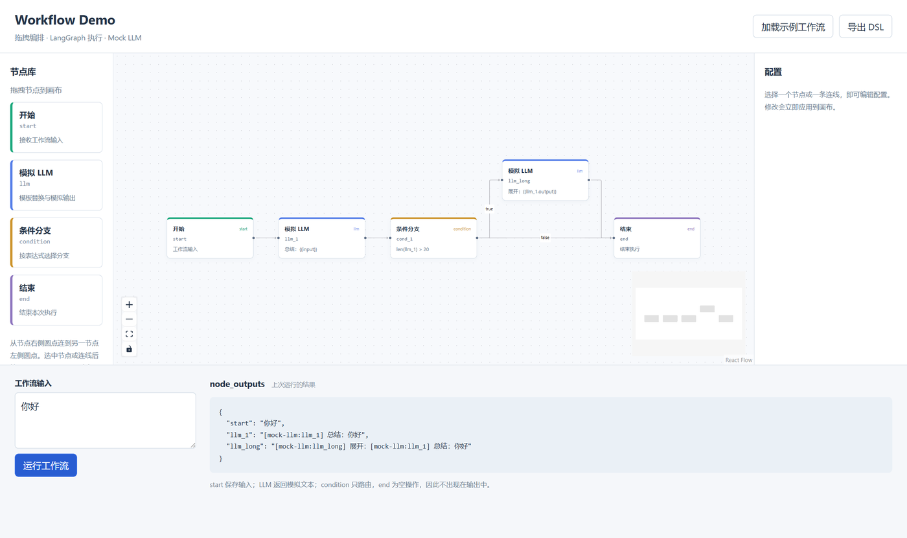

# Workflow Demo

一个可本地运行的类 Dify 拖拽工作流最小演示：React Flow 画布 → JSON DSL → FastAPI → 动态 LangGraph StateGraph → 节点输出。

无需数据库、鉴权、Docker、API Key 或真实 LLM 服务。依赖安装需要网络，运行时不调用外部模型。



## 环境与启动

- Python 3.11（建议创建虚拟环境）。
- Node.js 20.19+ 或 22.12+，附带 npm。
- 在项目根目录打开两个终端，分别运行以下命令。

后端：

```bash
cd backend && pip install -r requirements.txt && uvicorn app.main:app --reload --port 8000
```

前端：

```bash
cd frontend && npm install && npm run dev
```

Windows PowerShell 5 不支持 `&&`，可逐行运行相同命令：

```powershell
cd backend
python -m pip install -r requirements.txt
python -m uvicorn app.main:app --reload --port 8000
```

另一个终端：

```powershell
cd frontend
npm install
npm run dev
```

若使用虚拟环境，在安装前执行 `python -m venv .venv`，然后在 Windows 中执行 `.\.venv\Scripts\Activate.ps1`，或在 macOS/Linux 中执行 `source .venv/bin/activate`。请确保 `python` 指向 Python 3.11。

打开 **http://localhost:5173**。后端 API 文档为 http://localhost:8000/docs，健康检查为 http://localhost:8000/api/health。前端直接请求 `http://localhost:8000/api/run`，后端 CORS 允许 `http://localhost:5173`；请使用该地址访问页面。5173 被占用时 Vite 会报错，不会静默改端口。

## 操作步骤

1. 页面初始展示示例，也可以点击“加载示例工作流”重新载入。
2. 输入 `你好`，点击“运行工作流”，在 `node_outputs` 区查看结果。
3. 点击 `llm_1`，在右侧修改 `prompt_template`；支持 `{{input}}` 和 `{{llm_1.output}}` 这类上游引用。修改立即生效，节点 id 不可编辑。
4. 点击 `cond_1`，编辑 `expression`，如 `len(llm_1) > 20`。表达式中 `llm_1` 是输出字符串本身，不使用 `.output`。
5. 点击 condition 的出边，在右侧将 `condition` 设置为 `true` 或 `false`。
6. 从左侧拖入 start、llm、condition、end；拖动节点调整位置，从右侧圆点拖到目标左侧圆点连线。新增 id 自动生成并避开现有 id。
7. 选中节点或边后按 Delete / Backspace，或使用右侧“删除选中项”。删除节点同时删除相关边。
8. 点击“导出 DSL”，页面底部显示可复制的 JSON；不包含坐标、选中状态、React Flow 边 id 等 UI 信息。文本框是只读导出快照。

示例的执行路径：

```text
start → llm_1 → cond_1 ─true─→ llm_long → end
                     └false───────────→ end
```

输入 `你好` 时，`[mock-llm:llm_1] 总结：你好` 的长度为 21，因而走 true 分支：

```json
{
  "start": "你好",
  "llm_1": "[mock-llm:llm_1] 总结：你好",
  "llm_long": "[mock-llm:llm_long] 展开：[mock-llm:llm_1] 总结：你好"
}
```

将条件改成 `len(llm_1) > 200` 后再运行，将走 false 分支，输出仅包含 `start` 和 `llm_1`。也可保持原条件，输入 `你` 触发 false 分支。condition 只负责路由，end 是空操作，两者不添加业务输出；执行到 end 后图正常结束。

## DSL 与 API

示例文件位于 `examples/workflow.json`：

```json
{
  "nodes": [
    {"id": "start", "type": "start", "data": {}},
    {"id": "llm_1", "type": "llm", "data": {"prompt_template": "总结：{{input}}"}},
    {"id": "cond_1", "type": "condition", "data": {"expression": "len(llm_1) > 20"}},
    {"id": "llm_long", "type": "llm", "data": {"prompt_template": "展开：{{llm_1.output}}"}},
    {"id": "end", "type": "end", "data": {}}
  ],
  "edges": [
    {"source": "start", "target": "llm_1"},
    {"source": "llm_1", "target": "cond_1"},
    {"source": "cond_1", "target": "llm_long", "condition": "true"},
    {"source": "cond_1", "target": "end", "condition": "false"},
    {"source": "llm_long", "target": "end"}
  ]
}
```

`POST /api/run`，Content-Type 为 `application/json`：

```json
{"dsl": {"nodes": [], "edges": []}, "input": "你好"}
```

调用时将 `dsl` 替换为上面的完整示例。成功返回 `{"outputs": {...}}`；非法 DSL、表达式、缺失上游输出或超过执行步数返回 HTTP 400 和 `{"detail": "错误原因"}`，前端直接显示错误。

## 实现约定

- `WorkflowState` 包含 `input: str` 和 `node_outputs: dict[str, Any]`。start 记录原始输入；LLM 用节点工厂创建，替换变量并返回 `[mock-llm:节点id] ...`。节点更新使用字典合并保留已有输出。
- `NODE_FACTORIES` 注册 start、llm、end。condition 不调用 `add_node`；构建器将 `前驱 → condition` 转成前驱上的 `add_conditional_edges`，使用 condition 的表达式及出边决定下一个实际执行节点。支持连续条件节点，拒绝仅由条件节点构成的循环。
- 路由求值 locals 是 `node_outputs`，globals 禁用默认 builtins，仅提供 `len`。AST 白名单允许比较、布尔逻辑、常量及 len 调用。按照结果匹配 true/false，未匹配则使用 DSL 中最后一条出边。
- 一个 start，至少一个 end；节点必须从 start 可达。普通节点恰好一条出边，end 无出边；条件节点 1–2 条出边，显式标签不能重复。此最小版不支持普通节点的并行 fan-out，避免并发状态写入冲突。condition 路由允许汇入同一个目标。
- 节点 id 匹配 `^[A-Za-z_][A-Za-z0-9_]*$` 且唯一，另保留 `__start__`、`__end__`、`len`、`__builtins__`。边必须引用已有节点。
- 每个请求重新校验、构建、compile 并执行，不共享运行状态。LangGraph `recursion_limit=25`；包含实际执行节点的循环由此限制终止。
- **这是最小演示，eval 和 mock LLM 仅用于演示。生产环境不要用 eval，应替换成专用表达式解释器。** 本项目没有持久化、真实模型或生产服务治理。

## 验证

后端（在 backend 目录）：

```bash
python -m pip install -r requirements-dev.txt
python -m unittest discover -s tests -v
```

覆盖 true/false 分支、变量替换、输出合并、兜底路由、连续条件、非法 DSL、表达式限制、循环上限、请求状态隔离和 CORS。

前端（在 frontend 目录）：

```bash
npm run build
```

执行严格 TypeScript 检查和 Vite 生产构建。

## 目录

```text
backend/
  app/{main,models,nodes,graph_builder}.py
  tests/test_workflow.py
  requirements.txt
  requirements-dev.txt
frontend/
  src/App.tsx
  src/api.ts
  src/types.ts
  src/example.ts
  src/components/{NodePanel,CustomNode,ConfigPanel}.tsx
  src/main.tsx
  src/styles.css
  package.json
  tsconfig.json
  vite.config.ts
  index.html
examples/workflow.json
README.md
```

API 参考：[React Flow 拖拽](https://reactflow.dev/examples/interaction/drag-and-drop)、[LangGraph 条件边](https://reference.langchain.com/python/langgraph/graph/state/StateGraph/add_conditional_edges)。
